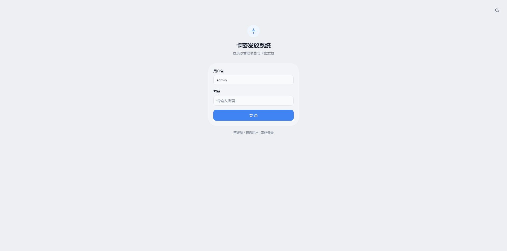
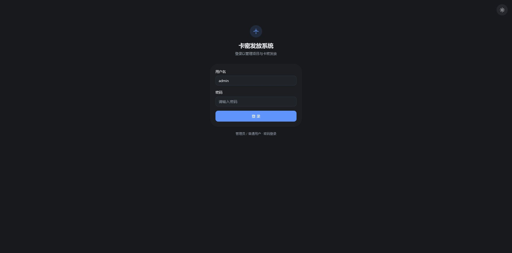
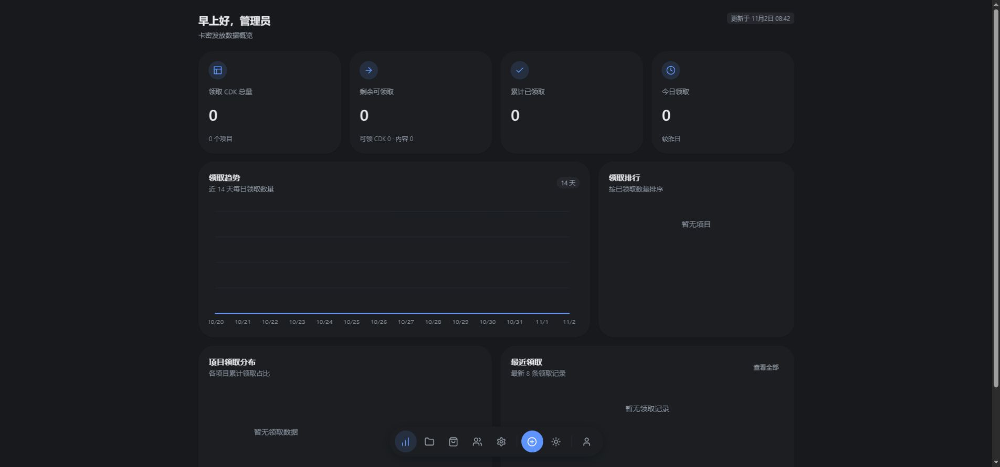

# luxury-cdk

一个用来批量发放兑换码、链接和文本的 CDK 管理系统。

先在后台建项目、导入要发的内容，再生成领取 CDK。用户拿着 CDK 到前台领取，系统记录这张码领走了哪份内容。内容和领取凭证分开管理，补库存、查记录、导出名单都在同一个项目里完成。

后端用 Express，数据放在 SQLite，前端是原生页面和 JavaScript。没有前端构建步骤，也不需要单独部署数据库。

## 界面

下面都是页面顶部的当前视口截图，没有滚动或拼接。后台截图来自空数据库。

| 浅色登录 | 深色登录 |
| --- | --- |
|  |  |



[移动端领取页首屏](docs/screenshots/claim-mobile-dark.jpg)

## 本地运行

在仓库根目录执行：

```sh
npm ci
npm start
```

开发时可以用 `npm run dev`，服务端文件变化后会重启；前端修改后刷新浏览器即可。当前验证环境为 Node.js 22。

- 前台领取：[http://localhost:8598/](http://localhost:8598/)
- 后台入口：[http://localhost:8598/admin](http://localhost:8598/admin)
- 登录页：[http://localhost:8598/admin/login](http://localhost:8598/admin/login)

`/admin` 和 `/admin/` 会跳转到登录页。已有有效会话时，登录页再进入概览。导航统一使用无后缀地址，旧的页面链接会重定向到新地址。

首次启动会创建 `data/card.db`，默认管理员为 `admin`，密码为 `admin123`。

`better-sqlite3` 需要原生模块。安装时若下载预编译包超时，可以检查网络后重试；只有无法使用预编译包时才需要本机 C++ 编译工具链。

## 配置与部署

| 环境变量 | 用途 |
| --- | --- |
| `PORT` | 监听端口，默认 `8598` |
| `ADMIN_PASSWORD` | 首次创建管理员时使用的密码，不会覆盖已有账号 |
| `JWT_SECRET` | JWT 签名密钥；部署时设置为足够长的随机值 |
| `TRUST_PROXY` | 受信任的反向代理，默认关闭 |

PowerShell 示例：

```powershell
$env:ADMIN_PASSWORD = "替换为初始管理员密码"
$env:JWT_SECRET = "替换为随机生成的长密钥"
npm start
```

Linux / macOS 示例：

```sh
ADMIN_PASSWORD='替换为初始管理员密码' \
JWT_SECRET='替换为随机生成的长密钥' npm start
```

默认密码和代码里的默认签名密钥仅用于本地试用。对外部署前设置自己的值，并在反向代理上启用 HTTPS。账号已创建后，修改 `ADMIN_PASSWORD` 不会重置密码；请在用户管理中处理，不要为了改密码删除数据库。

默认从 TCP 连接获取客户端 IP，不信任请求里的代理头。使用 Nginx 等代理时，根据实际链路设置 `TRUST_PROXY`，例如 `loopback`、指定 IP / CIDR，或固定的一层代理 `1`。不要在链路不确定时直接信任所有代理。

数据目录需要持久保存。备份时可以先停止服务，再复制整个 `data/` 目录；恢复后再启动。SQLite 使用 WAL，运行中不要只复制 `card.db` 而漏掉尚未合并的 WAL 数据。

## 使用流程

1. 登录后台，新建项目，填写名称、标签和可领取时间。
2. 导入分发内容，选择自动识别或指定兑换码、链接、文本类型。
3. 生成领取 CDK，或导入已有 CDK。生成结果支持单条复制、全部复制和 TXT 导出。
4. 把 CDK 发给用户。用户在前台输入后，领取一份内容。
5. 在项目详情或领取记录中查看发放情况，按需要导出 CSV。

导入按空白、逗号和分号拆分条目，并自动去重。包含空格的长文本也会被拆分，准备数据时要留意这一点。

### 两种领取模式

| 模式 | 内容何时确定 | 适合场景 |
| --- | --- | --- |
| 动态发放 | 领取时从剩余内容中分配 | 先到先得、后续补库存 |
| 一码一内容绑定 | 生成或导入 CDK 时绑定 | 提前确定每张 CDK 对应的内容 |

每张 CDK 只能领取一次。切换模式只影响后续生成或导入的码，已有绑定关系保留。绑定模式能生成的数量取决于尚未绑定的内容；动态模式可以先生成码，但内容不足时用户无法领取。

数据库用唯一索引保证 CDK 全局唯一、同一项目的内容不重复。领取在事务中完成：校验项目时间和库存、占用 CDK、分配内容、写入记录，任一步失败都会回滚。

旧版单层卡密数据会在启动时迁移为“领取 CDK + 分发内容”，原有领取码继续可用。升级前先备份数据。

## 后台功能

- **概览**：库存、累计领取、今日领取、近 14 天趋势、项目排行和最近记录。
- **项目**：标签、时间窗、领取模式、内容导入、CDK 生成和导入、搜索、状态筛选、分页及导出。
- **领取记录**：按项目和关键词查找 CDK、发放内容、领取 IP 与时间。
- **用户管理**：管理员可创建账号、封禁、解封、重置密码和删除账号；普通用户只管理自己的项目。
- **站点设置**：管理员可修改站点名称、公告和页脚。

封禁或删除账号后，其现有会话不能继续调用受保护接口。删除项目或用户会连带删除相关数据，操作前确认是否需要导出。

## 界面约定

浅深色都用四层底色区分页面、卡片、输入区域和悬停状态，相邻明度相差 2%。容器中的按钮不重复加边框；输入框的静态描边使用 inset 阴影，聚焦改为双环阴影。圆角按内部圆角与内边距计算。

暗色主题将字重数值统一减 40，实际显示效果取决于系统字体是否支持相应字重。数字使用等宽数字，正文启用 `text-wrap: pretty`。

少于 5 项的选项直接平铺；较多的项目用带边框的选择器，超过 10 项提供搜索，面板最高 264px。操作按钮点击即执行或打开确认框，不与数据选择器混用。移动端面板根据按钮位置向下或向上展开。

中文输入法选字时，以及选字结束后 500ms 内，回车不会触发提交。复制成功显示对勾，2.5 秒后恢复；重复复制重新计时。CDK 来源切换用 Grid 的 `0fr → 1fr` 折叠，收起内容不参与键盘聚焦。系统开启减少动态效果时关闭这些过渡。

## 目录

```text
src/
  server.js             Express 入口
  pages.js              页面路由与旧地址重定向
  auth.js               登录与权限校验
  db.js                 数据库初始化和迁移
  codes.js              CDK 生成、归一化和内容类型识别
  routes/               项目、领取、概览、用户与站点设置接口
public/
  admin/                后台页面及脚本
  js/                   前台领取、主题、对话框和通用交互
  css/                  主题样式与交互样式
test/                  路由和交互回归测试
docs/screenshots/      页面首屏截图
data/                  运行时数据库，不提交到仓库
```

## API

后台接口使用 `Authorization: Bearer <token>`。普通用户的项目接口按归属校验，用户管理和站点设置写入仅限管理员。

| 接口 | 用途 |
| --- | --- |
| `POST /api/auth/login` | 登录 |
| `GET /api/auth/me` | 当前账号 |
| `GET /api/dashboard/*` | 概览统计 |
| `GET/POST /api/batches` | 项目列表、创建项目 |
| `GET/PATCH/DELETE /api/batches/:id` | 项目详情、模式切换、删除 |
| `GET /api/batches/:id/contents` | 内容列表，支持关键词、状态和分页 |
| `POST /api/batches/:id/contents/import` | 导入内容 |
| `DELETE /api/batches/:id/contents/:contentId` | 删除未发放且未绑定的内容 |
| `GET /api/batches/:id/claim-codes` | CDK 列表，支持关键词、状态和分页 |
| `POST /api/batches/:id/claim-codes/generate` | 批量生成 CDK，返回本次生成的码 |
| `POST /api/batches/:id/claim-codes/import` | 导入 CDK，返回本次导入的码 |
| `DELETE /api/batches/:id/claim-codes/:codeId` | 删除未使用的 CDK |
| `GET /api/batches/:id/claim-codes/text` | CDK 纯文本清单 |
| `GET /api/batches/:id/claim-codes/export` | CDK CSV |
| `GET /api/batches/:id/export` | 内容发放明细 CSV |
| `GET /api/batches/:id/claims` | 项目领取记录 |
| `GET/POST /api/users` | 用户列表、新增用户 |
| `PATCH/DELETE /api/users/:id` | 账号管理 |
| `GET /api/claims/projects` | 公开的可领取项目列表 |
| `POST /api/claims` | 凭 CDK 领取内容 |
| `GET/PUT /api/settings` | 公开读取站点设置、管理员保存设置 |

## 验证

```sh
npm test
```

测试覆盖页面路由、旧地址重定向、静态资源、输入法回车边界、失效会话跳转及复制反馈计时。测试使用 Node.js 自带的测试运行器，不新增测试依赖。

界面调整后还需要在浏览器检查浅深色、窄屏、选择器与弹窗。截图只截页面顶部的当前视口，不做整页拼接。

## 许可

[MIT](LICENSE) © 2026 Buleng
